# Manual de Usuario — Kubo

**Kubo** es una plataforma web de almacenamiento en la nube. Permite guardar, organizar, descargar y compartir documentos, audios e imágenes dentro del espacio que ofrece cada plan.

Este manual está dirigido a las personas que **usan** la plataforma. La instalación, la arquitectura y la API se describen en el *Manual Técnico de Kubo*.

| Parte | Para quién |
|---|---|
| [Parte I — Cliente](#parte-i--manual-del-cliente) | Personas que guardan sus archivos en Kubo |
| [Parte II — Administración](#parte-ii--manual-de-administración) | Administradores y personal de soporte técnico |
| [Anexos](#anexos) | Formatos, límites, roles y preguntas frecuentes |

---

## Requisitos para usar Kubo

- Un navegador actualizado: Chrome, Edge, Firefox o Safari.
- Conexión a internet.
- Un correo electrónico al que tengas acceso (para verificar la cuenta y recuperar la contraseña).
- Dirección de la aplicación: la que indique el equipo (en el entorno de desarrollo, `http://localhost:5173`).

---

# Parte I — Manual del cliente

## 1. Página de inicio

Al abrir Kubo verás la página principal con la información del servicio.

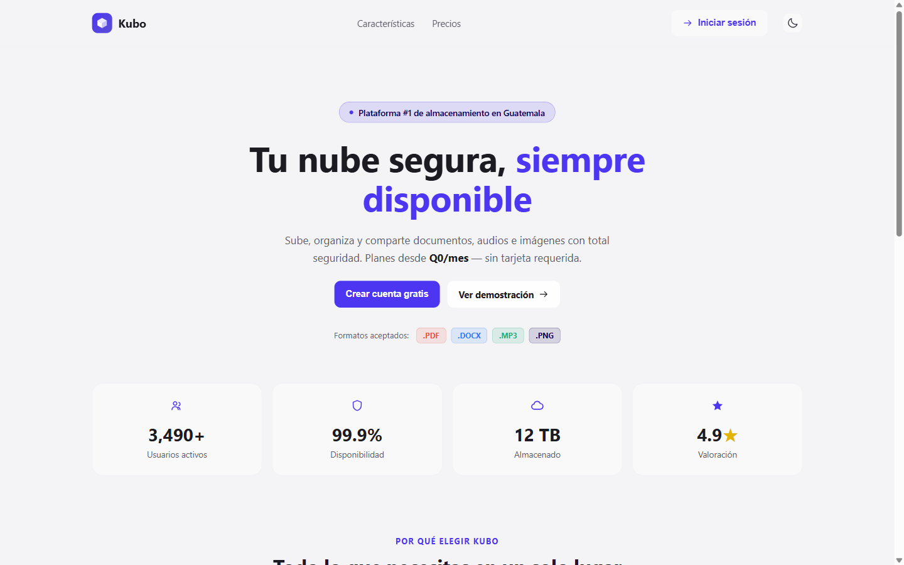

Desde aquí puedes:

- **Características** y **Precios**: bajan a la sección correspondiente de la página.
- **Iniciar sesión**: abre el formulario de acceso.
- **Crear cuenta gratis**: abre el formulario de registro.
- **Botón de luna/sol** (arriba a la derecha): cambia entre modo claro y modo oscuro.

## 2. Crear una cuenta

1. Haz clic en **Crear cuenta gratis** o en la pestaña **Registrarse**.
2. Escribe tu **nombre**, **apellido** y **correo electrónico**.
3. Crea una **contraseña** que cumpla los requisitos que se muestran en pantalla:
   - mínimo 8 caracteres,
   - una letra mayúscula,
   - un número o un símbolo.
4. Repite la contraseña en **Confirmar contraseña**.
5. Acepta los **Términos de Servicio** y la **Política de Privacidad**.
6. Haz clic en **Crear cuenta**.

Toda cuenta nueva empieza en el **plan FREE (5 GB)**. Podrás cambiar de plan después desde *Planes y Facturación*.

### 2.1 Verificar tu correo

Después de registrarte, Kubo envía un correo con un enlace de verificación.

1. Abre el correo de **Kubo** y haz clic en el enlace.
2. Verás un mensaje confirmando que tu correo quedó verificado.
3. Ya puedes iniciar sesión.

> **¿No llegó el correo?** Revisa la carpeta de spam. Si el enlace venció, en la pantalla de inicio de sesión usa la opción para **reenviar el enlace de verificación** y escribe tu correo.

## 3. Iniciar sesión

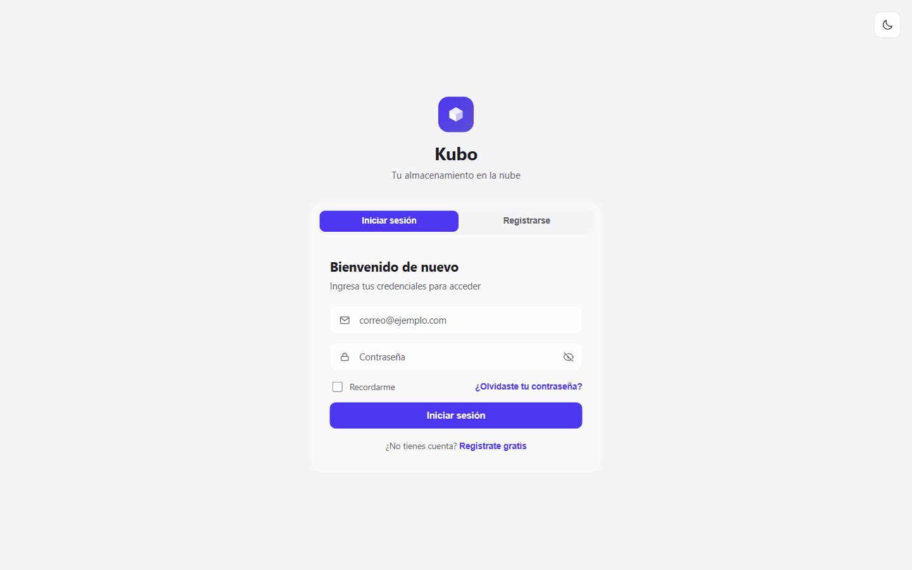

1. Escribe tu **correo electrónico** y tu **contraseña**.
2. El icono del ojo muestra u oculta la contraseña.
3. Marca **Recordarme** si usas tu propio equipo y quieres mantener la sesión.
4. Haz clic en **Iniciar sesión**.

Kubo te lleva automáticamente a tu espacio según tu tipo de cuenta: los clientes entran a **Mis Archivos**; administradores y soporte, a **Administración**.

### 3.1 Recuperar la contraseña

1. En la pantalla de inicio de sesión, haz clic en **¿Olvidaste tu contraseña?**
2. Escribe tu correo y haz clic en **Enviar enlace de recuperación**.
3. Abre el correo de Kubo y sigue el enlace (tiene un tiempo de vigencia limitado).
4. Escribe la nueva contraseña dos veces y guárdala.
5. Inicia sesión con la nueva contraseña.

## 4. Conoce tu espacio de trabajo

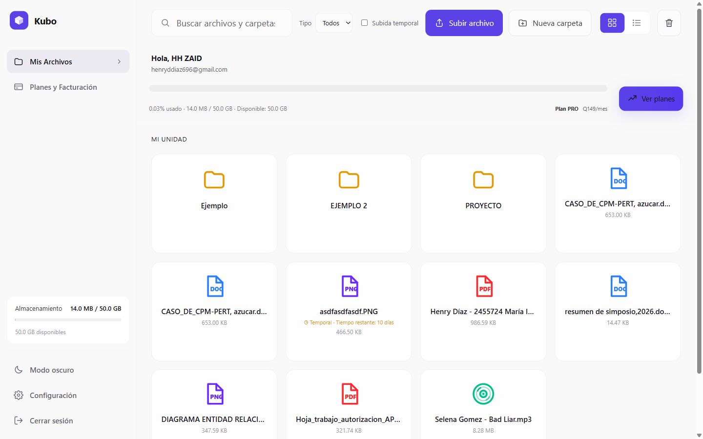

| Zona | Qué contiene |
|---|---|
| **Menú lateral (izquierda)** | *Mis Archivos*, *Planes y Facturación*, el recuadro de **Almacenamiento**, *Modo oscuro*, *Configuración* y *Cerrar sesión*. Haz clic en el cubo de Kubo para volver a la página de inicio. |
| **Barra superior** | Buscador, filtro por **Tipo**, casilla **Subida temporal** (planes de pago), botones **Subir archivo**, **Nueva carpeta**, cambio de vista (cuadrícula o lista) y el botón de **Papelera** (icono de bote de basura). |
| **Barra de uso** | Porcentaje usado, espacio usado / total, espacio disponible y tu plan. En el plan FREE aparece **Ampliar almacenamiento**; en los planes de pago, **Ver planes**. |
| **Mi unidad** | Tus carpetas y archivos. |

### 4.1 Usar Kubo en el celular

Kubo se adapta a la pantalla del teléfono:

- Arriba hay una **barra fija** con el botón **☰**, el logo y el nombre de la sección en la que estás. El botón **☰** abre el menú lateral; se cierra con la **X**, tocando fuera del menú o con **Esc**.
- En *Mis Archivos*, el buscador y el botón **Opciones** quedan en la primera fila. **Opciones** despliega el filtro por **Tipo**, la **Subida temporal**, el cambio de vista y la **Papelera**. Si tienes un filtro activo, el botón muestra cuántos.
- **Subir archivo** y **Nueva carpeta** quedan siempre visibles debajo del buscador.
- En *Planes y Facturación*, las secciones (Resumen, Planes, Método de pago, Historial) aparecen como **pestañas deslizables** bajo el título, y el historial se muestra como tarjetas.

| Mis Archivos con **Opciones** abierto | Menú lateral abierto |
|---|---|
| 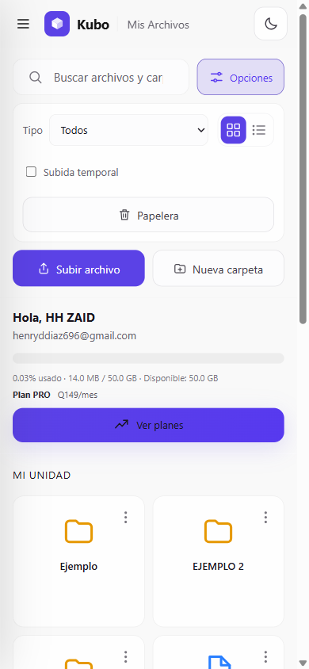 | 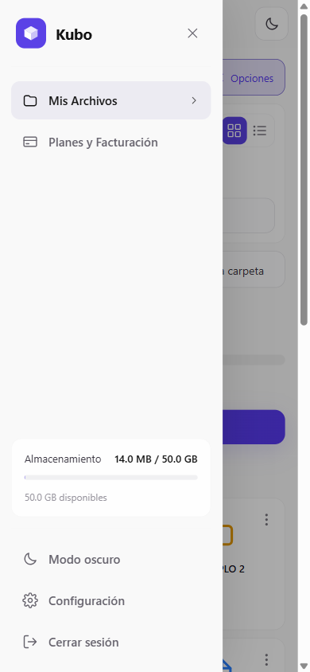 |

## 5. Archivos

### 5.1 Formatos y tamaño permitidos

Kubo acepta únicamente estos formatos:

| Tipo | Extensiones |
|---|---|
| Documentos PDF | `.pdf` |
| Documentos de Word | `.doc`, `.docx` |
| Audio | `.mp3` |
| Imágenes | `.png` |

Cada archivo puede pesar **hasta 100 MB**. Si intentas subir otro formato, verás el aviso **Formato no compatible**. Si no tienes espacio suficiente en tu plan, Kubo te indica cuánto espacio necesitas.

### 5.2 Subir un archivo

**Opción A: con el botón**
1. Entra a la carpeta donde quieres guardarlo (o quédate en *Mi unidad*).
2. Haz clic en **Subir archivo**.
3. Selecciona el archivo en tu equipo.

**Opción B: arrastrando**
1. Arrastra el archivo desde tu equipo hacia la ventana de Kubo.
2. Cuando aparezca **Suelta el archivo para subirlo**, suéltalo.

Al terminar, el archivo aparece en la cuadrícula y la barra de almacenamiento se actualiza.

### 5.3 Ver un archivo sin descargarlo *(PNG, PDF y MP3)*

Haz clic sobre una imagen **PNG**, un documento **PDF** o un audio **MP3** (o elige **Vista previa** en su menú **⋮**). Se abre una ventana con:

- **PNG:** la imagen completa.
- **PDF:** el documento con sus páginas, zoom e impresión.
- **MP3:** un reproductor de audio; el disco gira mientras suena.

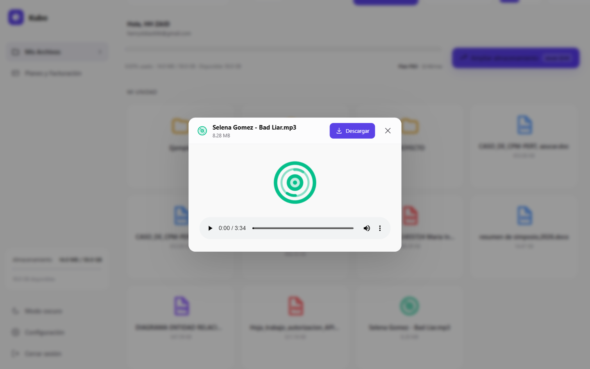

Desde la vista previa puedes pulsar **Descargar**. Para cerrarla usa la **X**, la tecla **Esc** o haz clic fuera de la ventana. En el celular la vista previa ocupa toda la pantalla.

### 5.4 Descargar un archivo

- Abre su menú **⋮** y elige **Descargar**, **o**
- pulsa **Descargar** dentro de la vista previa.

Los documentos **DOC** y **DOCX** no tienen vista previa: al hacer clic sobre ellos se descargan directamente.

### 5.5 Menú de opciones de un archivo

Cada archivo tiene un botón **⋮** en la esquina superior derecha:

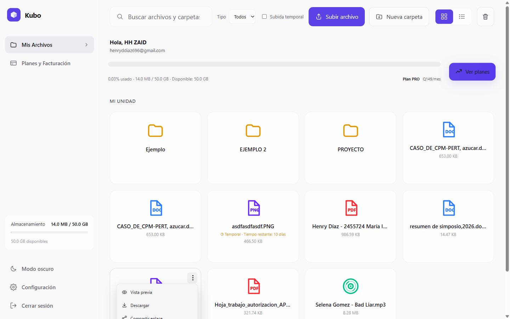

| Opción | Qué hace |
|---|---|
| **Vista previa** | Abre el archivo dentro de Kubo. *Solo PNG, PDF y MP3.* |
| **Descargar** | Guarda el archivo en tu equipo. |
| **Compartir enlace** | Crea un enlace de descarga para enviarlo a otra persona. *Solo planes de pago.* |
| **Renombrar** | Cambia el nombre. La extensión original se conserva. |
| **Mover a papelera** | Envía el archivo a la papelera por 30 días. |

### 5.6 Compartir un archivo *(planes PRO, PREMIUM y BUSINESS)*

1. Abre el menú **⋮** del archivo y elige **Compartir enlace**.
2. Kubo genera el enlace y muestra cuándo expira.
3. Haz clic en **Copiar** y envíalo por el medio que prefieras.

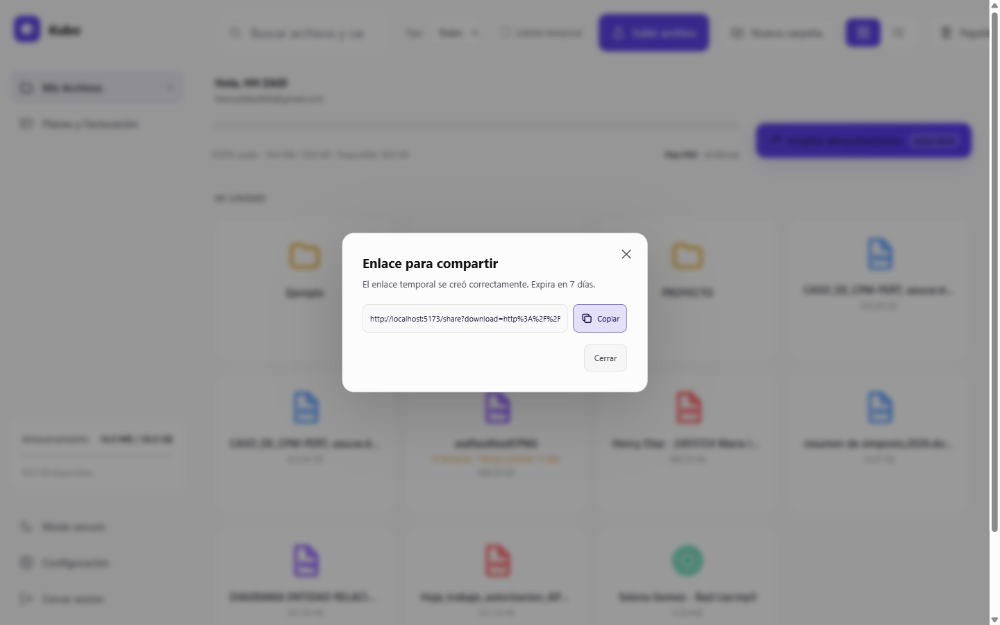

La persona que reciba el enlace **no necesita una cuenta de Kubo**: verá una página con el nombre del archivo, el tiempo que le queda al enlace y el botón para descargarlo (los audios se pueden reproducir ahí mismo). Cuando el enlace vence, la página muestra **El enlace ha expirado**.

> En el plan **FREE** la opción **Compartir enlace** no está disponible. Para usarla, cambia a un plan de pago.

### 5.7 Archivos temporales *(planes PRO, PREMIUM y BUSINESS)*

Un archivo temporal se elimina solo al cumplirse los días que elijas. Sirve para entregas puntuales o archivos que no necesitas conservar.

1. En la barra superior, marca **Subida temporal**.
2. En el campo **Días**, escribe cuántos días debe durar (de 1 a 365; por defecto 14).
3. Sube el archivo con **Subir archivo** o arrastrándolo.

El archivo mostrará la etiqueta **◷ Temporal · Tiempo restante: N días**. Desmarca **Subida temporal** para volver a subir archivos normales.

> En el plan **FREE** la casilla **Subida temporal** no aparece.

### 5.8 Buscar y filtrar

- **Buscador:** escribe parte del nombre del archivo o carpeta.
- **Tipo:** muestra solo PDF, MP3, DOC, DOCX o PNG. Elige **Todos** para quitar el filtro.
- **Vista:** el botón de cuadrícula muestra tarjetas; el de lista muestra filas con más detalle.

## 6. Carpetas

| Acción | Cómo hacerla |
|---|---|
| **Crear carpeta** | Haz clic en **Nueva carpeta**, escribe el nombre (ej. *Proyectos 2026*) y confirma con **Crear carpeta**. Se crea dentro de la carpeta en la que estás. |
| **Abrir carpeta** | Haz clic sobre la carpeta. Para volver, haz clic en **Mi unidad**. |
| **Renombrar carpeta** | Menú **⋮** de la carpeta → **Renombrar** → escribe el nuevo nombre → **Guardar cambios**. |
| **Eliminar carpeta** | Menú **⋮** → **Mover a papelera**. La carpeta **y todo su contenido** van a la papelera por 30 días. |

## 7. Papelera

Haz clic en el botón de **Papelera** (bote de basura) en la barra superior. En el celular está dentro de **Opciones**.

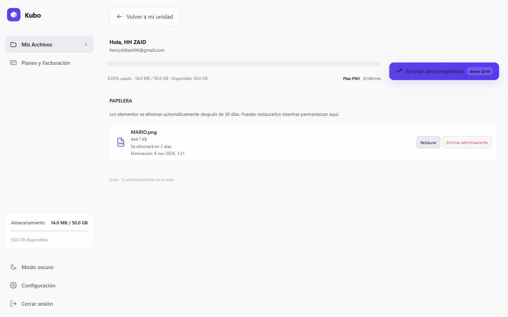

- Cada elemento muestra su tamaño, cuántos días le quedan y la fecha exacta en la que se eliminará.
- **Restaurar:** devuelve el archivo o carpeta a su ubicación.
- **Eliminar definitivamente:** se habilita cuando el elemento cumple sus 30 días en la papelera.
- Los elementos se borran automáticamente a los 30 días.
- Para salir, haz clic en **Volver a mi unidad**.

> Los archivos en la papelera **siguen contando** en tu espacio usado hasta que se eliminan.

## 8. Planes y facturación

En el menú lateral, haz clic en **Planes y Facturación**. Se despliegan cuatro secciones.

### 8.1 Resumen

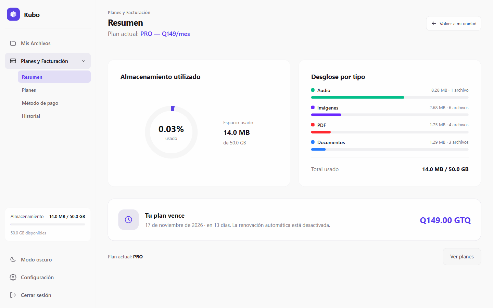

Muestra:

- **Almacenamiento utilizado:** anillo con el porcentaje y el espacio usado de tu total.
- **Desglose por tipo:** cuánto espacio ocupan tus **Audios**, **Imágenes**, **PDF** y **Documentos** (DOC/DOCX), con el número de archivos de cada tipo. Incluye lo que está en la papelera.
- **Tu plan vence / Próximo cobro:** la fecha con los días restantes, el monto e indica si la renovación automática está activa.

### 8.2 Planes

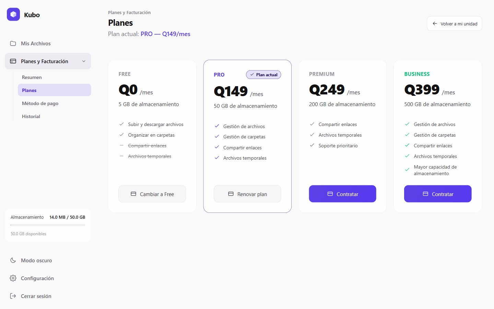

| Plan | Espacio | Precio mensual | Subir y descargar | Compartir enlaces | Archivos temporales |
|---|---|---|---|---|---|
| **FREE** | 5 GB | Q0 | ✓ | ✗ | ✗ |
| **PRO** | 50 GB | Q149 | ✓ | ✓ | ✓ |
| **PREMIUM** | 200 GB | Q249 | ✓ | ✓ | ✓ |
| **BUSINESS** | 500 GB | Q399 | ✓ | ✓ | ✓ |

*Los planes y precios los define el administrador y pueden cambiar; la pantalla **Planes** siempre muestra los vigentes.*

- Cada tarjeta muestra con **✓** lo que incluye el plan y **tachado** lo que no incluye (por ejemplo, el FREE muestra tachados *Compartir enlaces* y *Archivos temporales*).
- Tu plan aparece marcado como **Plan actual**.
- **Contratar:** inicia el pago de otro plan.
- **Renovar plan:** paga un nuevo periodo del plan que ya tienes.
- **Cambiar a Free:** vuelve al plan gratuito.

> Las funciones de pago (compartir y temporales) se activan **después** de que el pago es aprobado y se mantienen mientras la suscripción esté vigente. Si la suscripción vence, vuelves a tener las funciones del plan FREE; tus archivos no se borran.

### 8.3 Método de pago (contratar o renovar)

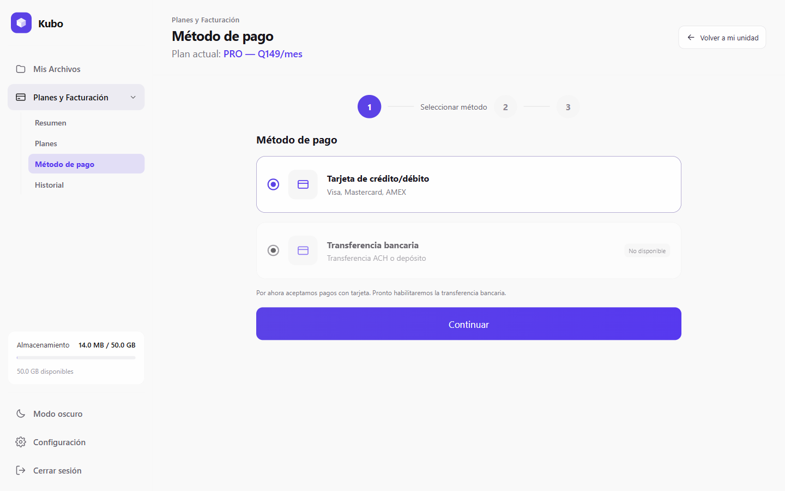

El pago tiene tres pasos:

1. **Seleccionar método:** elige **Tarjeta de crédito/débito** (Visa, Mastercard, AMEX). La transferencia bancaria aún no está disponible. Haz clic en **Continuar**.
2. **Datos de pago:** escribe el número de la tarjeta y su vencimiento. Revisa el **Resumen del pedido** (plan, ciclo mensual, total).
3. **Confirmar:** haz clic en **Confirmar pago**. Si se aprueba, verás *Tu plan se actualizó correctamente.* y la referencia del pago.

Si el pago es rechazado, Kubo muestra el motivo y tu plan no cambia. Puedes intentarlo de nuevo.

> En el entorno académico los pagos son **simulados**: no se realiza ningún cobro real.

### 8.4 Historial

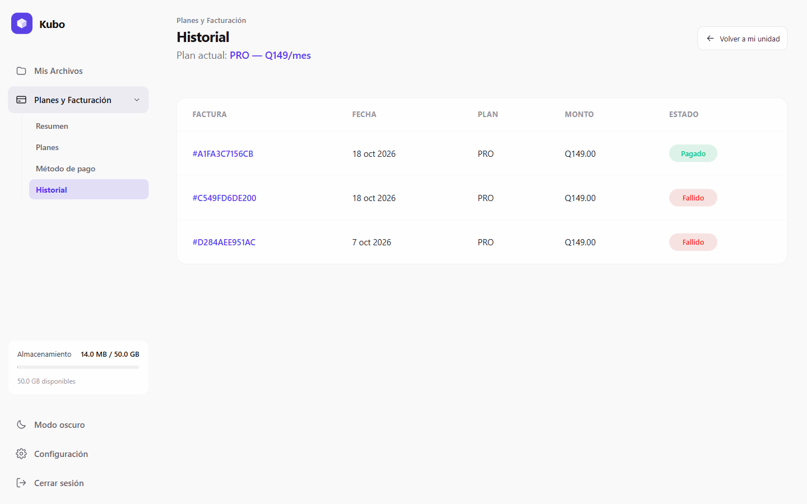

Lista todos tus pagos con su número de referencia, fecha, plan, monto y estado: **Pagado**, **Pendiente** o **Fallido**.

## 9. Configuración de la cuenta

En el menú lateral, haz clic en **Configuración**.

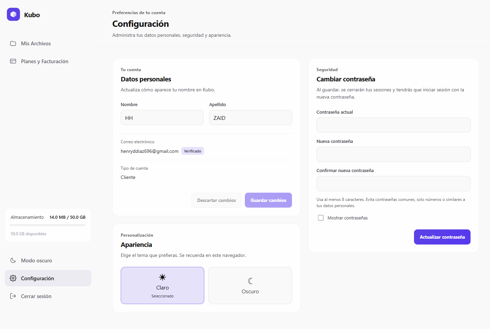

### 9.1 Datos personales
1. Cambia tu **Nombre** o **Apellido**.
2. Haz clic en **Guardar cambios** (o **Descartar cambios** para deshacer).

Aquí también ves tu correo (con la etiqueta **Verificado**) y tu tipo de cuenta.

### 9.2 Cambiar contraseña
1. Escribe tu **Contraseña actual**.
2. Escribe la **Nueva contraseña** y confírmala.
3. Marca **Mostrar contraseñas** si quieres revisarlas.
4. Haz clic en **Actualizar contraseña**.

Al guardar, **se cierran todas tus sesiones** y debes entrar de nuevo con la nueva contraseña.

### 9.3 Apariencia
Elige **Claro** u **Oscuro**. La preferencia se recuerda en ese navegador. También puedes cambiarla desde **Modo oscuro / Modo claro** en el menú lateral.

## 10. Cerrar sesión

Haz clic en **Cerrar sesión** al final del menú lateral. Hazlo siempre en equipos compartidos.

---

# Parte II — Manual de administración

Esta parte cubre las cuentas internas de Kubo:

| Rol | Qué puede hacer |
|---|---|
| **Administrador** | Todo: inicio con resumen, usuarios (incluye crear soporte y editar roles), pagos, planes, estadísticas y auditoría. |
| **Soporte técnico** | Consultar usuarios y su detalle, activar o desactivar cuentas y consultar el historial global de pagos. |

Las cuentas internas **no tienen plan ni almacenamiento personal**: no ven *Mis Archivos* ni *Planes y Facturación*.

Al iniciar sesión, el administrador entra a **Administración → Inicio** y el personal de soporte a **Administración → Usuarios**. El menú lateral muestra solo las secciones permitidas para cada rol.

## 11. Inicio *(solo administrador)*

Ruta: **Administración → Inicio**

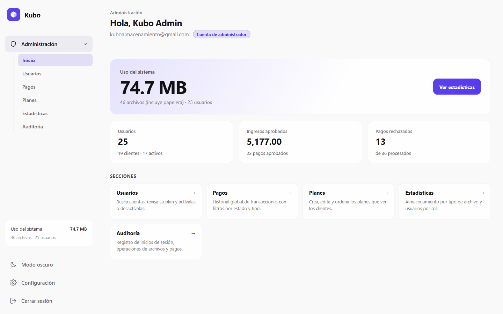

- **Saludo** con tu nombre y la etiqueta *Cuenta de administrador*.
- **Uso del sistema:** espacio total usado en Kubo, número de archivos (incluye papelera) y de usuarios. El botón **Ver estadísticas** abre el detalle.
- **Tarjetas de resumen:**
  - *Usuarios*: total, clientes y clientes activos.
  - *Ingresos aprobados*: suma de pagos aprobados.
  - *Pagos rechazados*: cantidad, sobre el total procesado.
- **Secciones:** accesos rápidos a Usuarios, Pagos, Planes, Estadísticas y Auditoría.

En el menú lateral, el recuadro **Uso del sistema** reemplaza al de almacenamiento personal; al hacer clic lleva a Estadísticas.

## 12. Usuarios *(administrador y soporte)*

Ruta: **Administración → Usuarios**

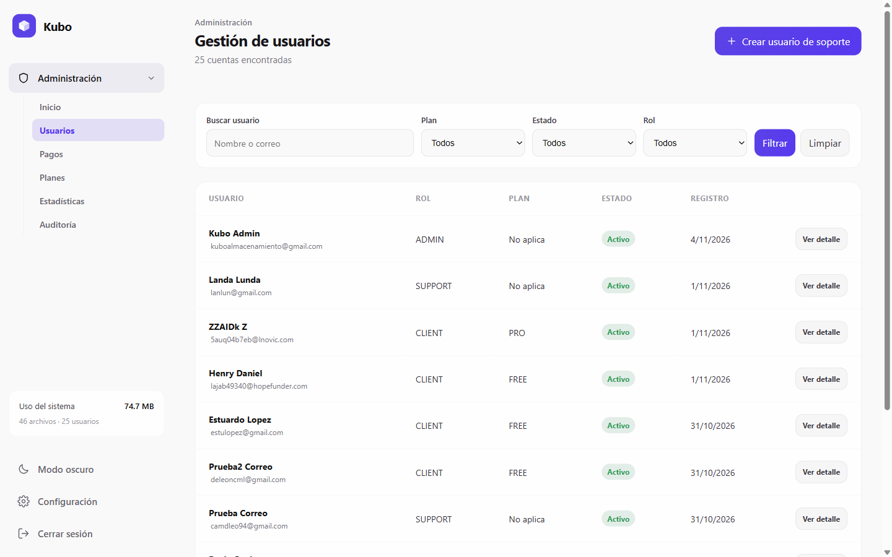

### 12.1 Buscar y filtrar
1. En **Buscar usuario**, escribe un nombre o correo. *(En el celular, toca **Filtros** para desplegar el formulario.)*
2. Usa los filtros disponibles:
   - **Estado:** Todos, Activos, Desactivados.
   - **Plan:** Free, Pro, Premium, Business.
   - **Rol** *(solo administrador)*: Cliente, Soporte, Administrador.
3. Haz clic en **Filtrar**. **Limpiar** quita todos los filtros.

Si no hay resultados verás *No hay usuarios para mostrar — Prueba con otros filtros o una búsqueda diferente.* La lista está paginada.

### 12.2 Ver el detalle de un usuario
Haz clic en **Ver detalle**. La ficha muestra:

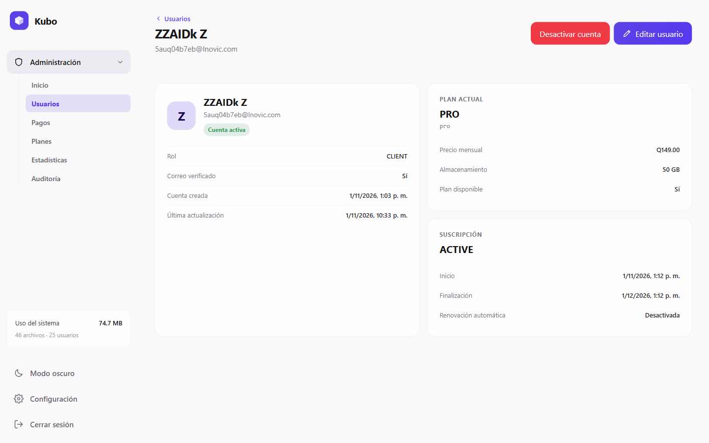

- **Información del usuario:** nombre, correo, rol, si el correo está verificado, fecha de creación y última actualización.
- **Plan y almacenamiento** (solo clientes): plan actual, precio mensual y espacio.
- **Suscripción:** estado, fecha de finalización y si tiene renovación automática.
- **Pagos del usuario:** su historial de transacciones. En cada pago, **Ver detalle** abre la ventana **Detalle del pago** con la referencia, el método, la fecha y, si fue rechazado, el **motivo del rechazo**.

En cuentas internas (soporte o administrador) aparece: *Esta cuenta no tiene plan, suscripción ni almacenamiento personal.*

### 12.3 Activar o desactivar una cuenta
1. En el detalle del usuario, haz clic en **Desactivar cuenta** (o **Activar cuenta**).
2. El estado cambia a *Cuenta desactivada* / *Cuenta activa*.

Una cuenta desactivada no puede iniciar sesión. Úsalo, por ejemplo, para suspender temporalmente a un cliente por incumplir los términos de uso. Sus archivos no se borran.

### 12.4 Editar un usuario *(solo administrador)*
1. En el detalle, haz clic en **Editar usuario**.
2. Cambia **Nombre**, **Apellido**, **Correo electrónico** o **Rol**.
3. Haz clic en **Guardar cambios**.

Ten en cuenta:
- Si cambias el **correo**, el usuario debe verificar la nueva dirección antes de volver a entrar.
- Si asignas un **rol interno** (Soporte o Administrador) a un cliente, se le quita el plan personal y se cancela su suscripción.
- Si conviertes una cuenta interna en **Cliente**, empieza con el plan FREE.

### 12.5 Crear un usuario de soporte *(solo administrador)*
1. En la lista de usuarios, haz clic en **Crear usuario de soporte**.
2. Escribe **Nombre**, **Apellido**, **Correo electrónico**, **Contraseña** y **Confirmar contraseña**.
3. Confirma.

La cuenta queda con rol **Soporte** y puede iniciar sesión de inmediato.

## 13. Pagos *(administrador y soporte)*

Ruta: **Administración → Pagos** — *Historial global de pagos*

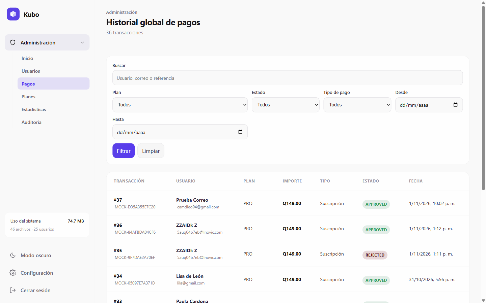

1. **Buscar:** usuario, correo o referencia. *(En el celular, los filtros están dentro de **Filtros**.)*
2. Filtros: **Estado** (Aprobado, Rechazado), **Tipo de pago** (Suscripción, Renovación), **Plan**, rango de fechas **Desde / Hasta**.
3. **Filtrar** aplica; **Limpiar** reinicia.
4. Haz clic en el nombre del usuario de un pago para abrir su ficha; ahí, en *Pagos del usuario*, **Ver detalle** muestra el **Detalle del pago** (referencia, método, fecha y, si fue rechazado, el **motivo del rechazo**).

Úsalo para atender reclamos de clientes sobre cobros o renovaciones fallidas.

## 14. Planes *(solo administrador)*

Ruta: **Administración → Planes** — *Gestión de planes*

La tabla muestra cada plan con su precio, almacenamiento, beneficios, si es visible y las acciones (lápiz para editar, bote de basura para eliminar).

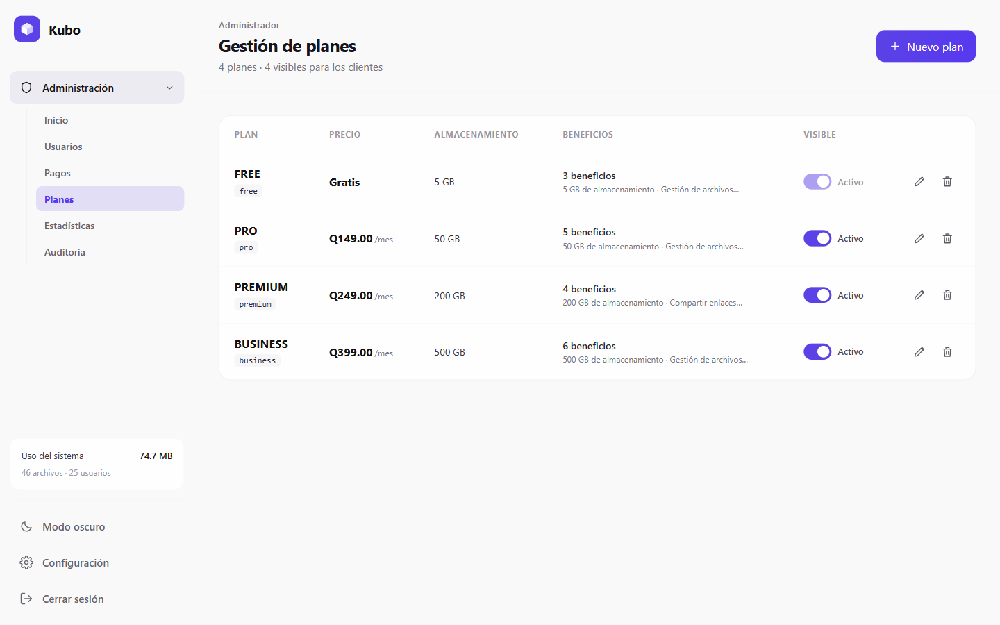

### 14.1 Crear un plan
1. Haz clic en **Nuevo plan**.
2. Completa:
   - **Nombre** (ej. *PREMIUM*).
   - **Código**: identificador interno en minúsculas, números y guiones (ej. `premium`).
   - **Precio mensual** en quetzales.
   - **Almacenamiento** en GB.
   - **Plan activo**: si está desmarcado, los clientes no lo ven.
3. **Funciones incluidas:** marca **Archivos temporales** y/o **Compartir enlaces**. Solo se pueden activar en planes con precio mayor a Q0; se habilitan para el cliente después del pago y mientras su suscripción esté vigente.
4. **Descripción de beneficios:** textos que aparecen en la tarjeta del plan (ej. *Gestión de carpetas*). Usa **Agregar beneficio**, las flechas para ordenarlos y la **X** para quitarlos. Estos textos son informativos: no activan funciones.
5. Haz clic en **Crear plan**.

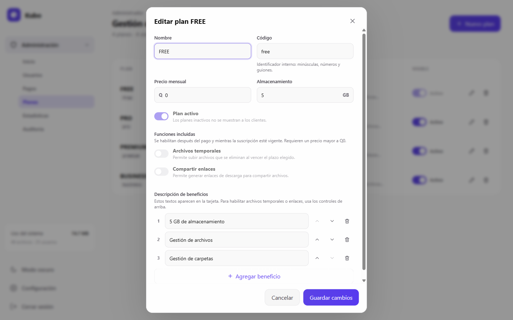

### 14.2 Editar, activar o desactivar
- **Editar** abre el mismo formulario con los datos del plan; guarda con **Guardar cambios**.
- **Desactivar / Activar** oculta o muestra el plan a los clientes sin borrarlo. Los clientes que ya lo tienen lo conservan hasta que vence su suscripción.

### 14.3 Eliminar
Haz clic en **Eliminar** y confirma con **Eliminar plan**. **La acción no se puede deshacer.** Si solo quieres que los clientes dejen de verlo, es mejor desactivarlo.

> El plan **FREE** es el plan base de todas las cuentas nuevas. No admite funciones de pago y no debe eliminarse.

## 15. Estadísticas *(solo administrador)*

Ruta: **Administración → Estadísticas**

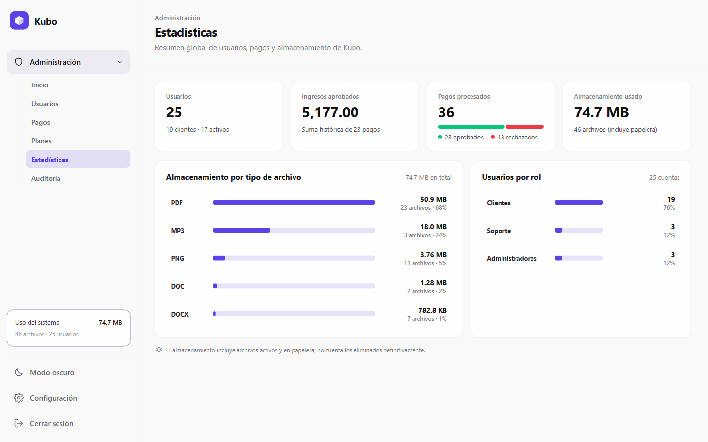

Resumen global de usuarios, pagos y almacenamiento:
- **Almacenamiento usado** total.
- **Usuarios** totales y **Usuarios por rol** (clientes, soporte, administradores).
- **Pagos procesados** e **Ingresos aprobados**.
- **Almacenamiento por tipo de archivo** (PDF, DOC/DOCX, MP3, PNG).

El almacenamiento incluye archivos activos y en papelera; no cuenta los eliminados definitivamente.

## 16. Auditoría *(solo administrador)*

Ruta: **Administración → Auditoría**

Registro de lo que ocurre en Kubo. Cada evento muestra **Fecha**, **Usuario**, **Acción**, **Recurso** y **Detalles**.

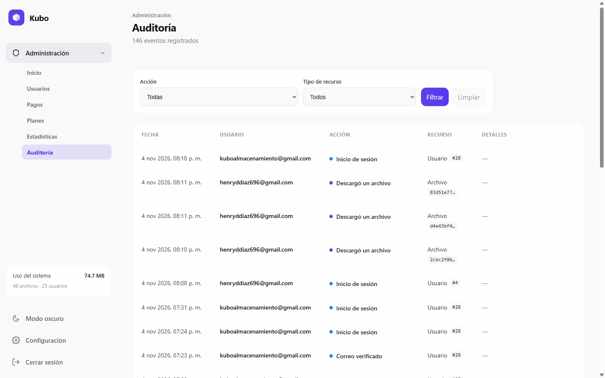

Filtra por **Acción** y **Tipo de recurso** y haz clic en **Filtrar**. Las acciones se agrupan así:

| Grupo | Ejemplos de acciones |
|---|---|
| **Cuenta** | Registro, Inicio de sesión, Correo verificado, Cambió su contraseña, Contraseña restablecida, Actualizó sus datos |
| **Usuarios** | Creó un usuario de soporte, Actualizó un usuario |
| **Archivos** | Subió, Descargó, Compartió, Restauró o Eliminó un archivo; Archivo a papelera |
| **Carpetas** | Carpeta a papelera, Restauró una carpeta, Eliminó una carpeta |
| **Pagos y planes** | Pago procesado, Cambio de plan (ej. *PRO → PREMIUM*), Renovación |
| **Sistema** | Limpieza automática de papelera |

## 17. Configuración de la cuenta interna

Igual que para clientes ([sección 9](#9-configuración-de-la-cuenta)): datos personales, cambio de contraseña y apariencia. El tipo de cuenta aparece como *Administrador* o *Soporte*.

---

# Anexos

## A. Límites del servicio

| Concepto | Valor |
|---|---|
| Formatos permitidos | PDF, DOC, DOCX, MP3, PNG |
| Tamaño máximo por archivo | 100 MB |
| Espacio del plan FREE | 5 GB |
| Permanencia en papelera | 30 días |
| Duración de un archivo temporal | 1 a 365 días (14 por defecto) |
| Duración de un enlace compartido | 7 días |
| Vista previa | PNG, PDF y MP3 |

## B. Permisos por rol

| Función | Cliente | Soporte | Administrador |
|---|---|---|---|
| Subir y descargar sus archivos | ✓ | — | — |
| Compartir y archivos temporales | Solo plan de pago | — | — |
| Ver y contratar planes | ✓ | — | — |
| Historial de pagos propio | ✓ | — | — |
| Ver usuarios y su detalle | — | ✓ | ✓ |
| Activar / desactivar cuentas | — | ✓ | ✓ |
| Editar usuarios y roles | — | — | ✓ |
| Crear usuarios de soporte | — | — | ✓ |
| Historial global de pagos | — | ✓ | ✓ |
| Crear, editar y eliminar planes | — | — | ✓ |
| Estadísticas y auditoría | — | — | ✓ |

## C. Preguntas frecuentes

**¿Puedo ver un archivo sin descargarlo?**
Sí, si es PNG, PDF o MP3: haz clic sobre él y se abre la vista previa. Los DOC y DOCX se descargan.

**No veo "Compartir enlace" ni "Subida temporal".**
Estás en el plan FREE, tu pago aún no fue aprobado o tu suscripción venció. Revisa *Planes y Facturación → Resumen*.

**Subí un archivo y dice "Formato no compatible".**
Solo se aceptan PDF, DOC, DOCX, MP3 y PNG. Convierte el archivo a uno de esos formatos.

**Me quedé sin espacio.**
Recuerda que los archivos en la papelera siguen ocupando espacio hasta que se eliminan (a los 30 días). Elimina lo que no necesites o cambia a un plan con más almacenamiento.

**Borré algo por error.**
Entra a **Papelera** y haz clic en **Restaurar**. Tienes 30 días.

**No puedo iniciar sesión.**
Verifica tu correo y contraseña; si no recuerdas la contraseña, usa *¿Olvidaste tu contraseña?* Si tu cuenta no está verificada, reenvía el enlace de verificación. Si aun así no entras, tu cuenta puede estar desactivada: contacta al administrador.

**¿Qué pasa con mis archivos si mi plan vence?**
No se borran. Vuelves a las funciones del plan FREE. Si usas más de 5 GB no podrás subir archivos nuevos hasta liberar espacio o renovar.

**¿El enlace compartido sigue funcionando si cambio el nombre del archivo?**
Sí, hasta su fecha de expiración.
